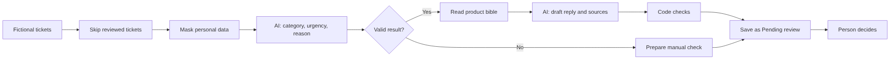
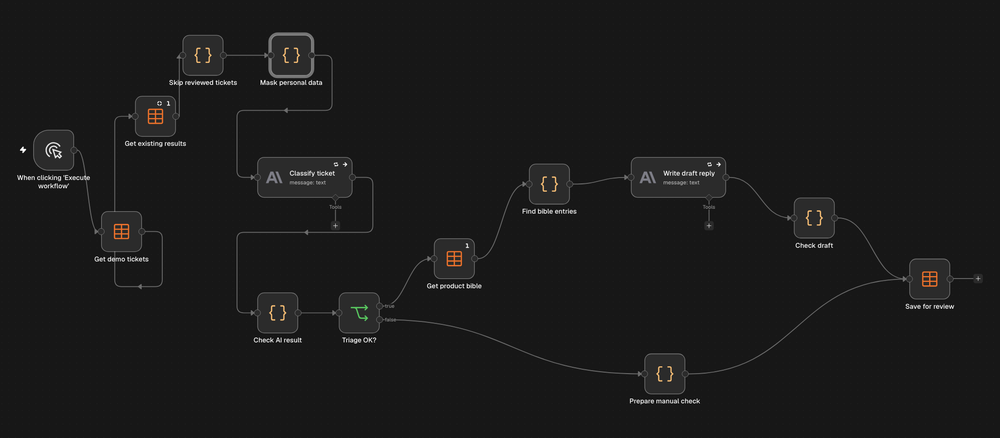
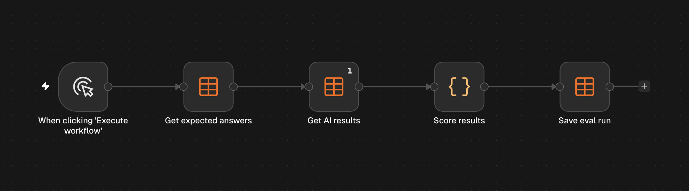

# Ticket Triage: AI-assisted support workflow in n8n

A portfolio project using fictional tickets for a fictional product. It shows how a support team could sort tickets, prepare replies from a product knowledge base and keep a person in charge. It does not contact customers.

## Problem

Support teams spend time reading every ticket, judging its urgency and searching for the right answer. Serious problems can look minor, and a confident AI reply can be wrong if it is not tied to confirmed product knowledge.

## What it does

1. Reads tickets from an n8n data table.
2. Skips tickets that a person has already handled.
3. Masks personal data before anything is sent to the model.
4. Uses an LLM to assign a category, urgency and short reason.
5. Checks that the AI result uses allowed values.
6. Reads a fictional product bible with rules and confirmed facts.
7. Writes a draft reply and lists the bible entries it used.
8. Checks the draft with code.
9. Saves everything as `Pending review`, with a clear list of knowledge gaps and warnings.

## Key design decisions

- **Human review:** nothing goes to a customer. A person makes the final decision.
- **Confirmed knowledge only:** the model can use only the product bible. If the answer is missing or unconfirmed, it reports the gap.
- **Masking before AI:** the model receives masked text, while the reviewer can see the original ticket.
- **Code checks after AI:** code verifies sources, panel paths, draft length, risky promises, internal labels and placeholders.
- **Safe failure:** AI calls retry up to three times. A failed ticket goes to a person instead of stopping the whole run.
- **Protected decisions:** a new run does not overwrite a ticket once its status is no longer `Pending review`.
- **Separate evaluation:** a second workflow scores results against expected answers without using AI.

## Test results

| Test | Result |
| --- | --- |
| 30 unseen tickets, category | 30 of 30 |
| 30 unseen tickets, urgency | 29 of 30 |
| 30 unseen tickets, human review decision | 29 of 30, with none wrongly marked as not needing a person |
| Prompt injection attempts in the unseen set | 2 of 2 resisted |
| Masking on 16 unseen edge cases | 11 of 16 |

After that test, I fixed the problems it found, reran the affected tickets and tested five new tickets. All five matched the expected category, urgency and review decision. See `test-results.md` for details.

These are small tests on fictional data, and I set the expected answers myself. They do not prove production accuracy.

## Tools

- n8n
- n8n Data Tables
- JavaScript in n8n Code nodes
- Anthropic Claude Haiku
- Claude for AI-assisted building, review and testing

## My role

I built this project with AI assistance. I defined the workflow rules, used synthetic data, required human review and confirmed-only answers, reviewed the test results and chose the improvements.

## What broke and what I changed

- **Token limit:** the model used part of its limit for reasoning, so JSON answers were cut off. I raised the limits and kept checks for invalid JSON.
- **Repeated knowledge:** the bible was fetched once per ticket, so every AI call received repeated text. I changed the node to run once.
- **Wrong knowledge selection:** choosing bible entries only by category hid useful entries for mixed tickets. The small demo now sends the full bible.
- **Too broad security rule:** a simple password reset request was treated as a security incident. I narrowed the rule.
- **Masking mistakes:** dates looked like phone numbers, names with accents were missed, and the name Theo changed the word `the`. Each case became a test.
- **Weak draft steps:** the model repeated steps customers had already tried. A new rule now requires steps to fit the problem.
- **False alarm:** a draft check removed `Home` from `Home > Dashboard`. I changed the order of the checks.

## Limits

- All tickets, customers and product knowledge are fictional.
- Rule-based masking misses some names and sometimes masks normal text. Real customer data would need a stronger detection tool running inside the company environment, plus legal and security approval.
- Sending the full bible works only for a small knowledge base. A large bible would need retrieval, often called RAG.
- Code checks can catch risky wording, but they cannot judge whether every suggestion is sensible.
- Original tickets remain in n8n tables and execution history, so a real deployment would need access rules and retention settings.

## Files

- `Ticket Triage.json`: main n8n workflow export
- `demo_tickets.csv`: fictional tickets with expected answers
- `product_bible.csv`: fictional rules and product knowledge
- `ticket-triage-results.csv`: saved results for all 48 fictional tickets
- `sample-results.md`: example outputs from test runs
- `test-results.md`: test method, results and limits
- `workflow-diagram.png`: workflow overview
- `workflow.png`: n8n workflow screenshot
- `eval-workflow.png`: evaluation workflow screenshot

## Next improvements

- Add a review screen with Approve, Edit and Reject actions.
- Add a stronger personal data detection tool.
- Add alerts for urgent tickets and failed runs.
- Log token use and cost per run.
- Add retrieval for a larger knowledge base.
- Expand the unseen test set.

## Screenshots

